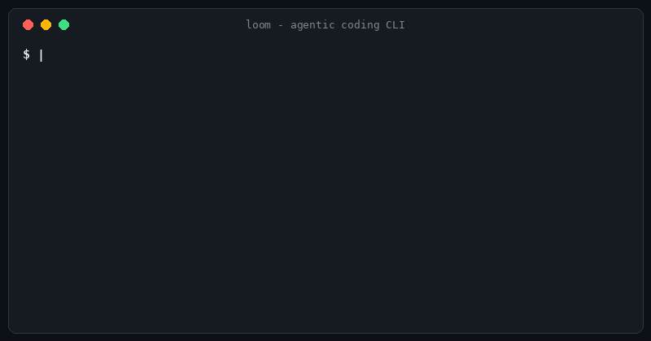
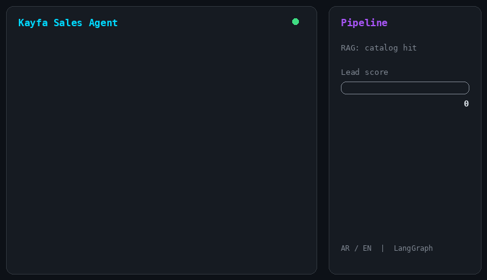
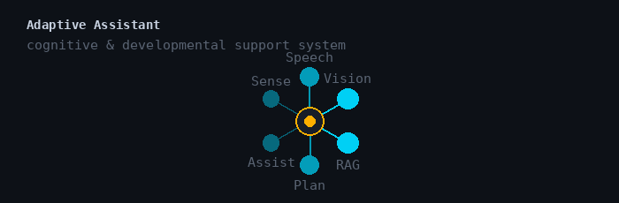
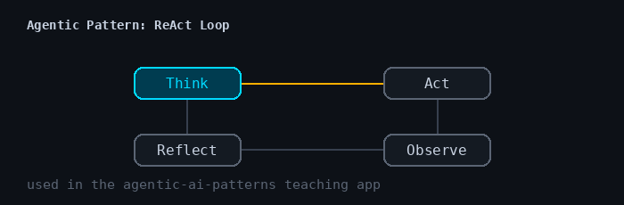

---

### 👋 About Me

I'm **Yousef Malak**, a fourth year Computer Science student at Ain Shams University and an **AI Engineer at Datalentech**. I lead the AI department at **iCLUB**, my university's tech club, and spend most of my time building agentic AI systems — multi-agent pipelines, RAG systems, and tools that make LLMs actually useful in production.

- 🏗️ Hands-on with **LangGraph**, **RAG**, **pgvector**, and computer vision (**YOLO**)
- 🧩 Interested in eval-driven development for agentic AI — making agent behavior measurable, not just "vibes"
- 🏆 Competitive programmer, grinding CSES and preparing for **ACPC**
- 🎓 GPA 3.5

---

## ⚡ What I'm Building

### 🧵 Loom CLI
An agentic coding CLI (à la OpenCode / Claude Code) in Python — Typer + LangGraph + Rich, multi-provider (Anthropic / OpenRouter / NVIDIA / Groq), with support for defining custom multi-agent architectures.

### 🛍️ Kayfa Sales Agent
Multilingual (Arabic/English) LangGraph sales chatbot built during my internship at Kayfa — RAG over a 52-course catalog, lead scoring, CRM integration, WhatsApp notifications via Twilio.

### 🎓 Graduation Project
An AI-powered assistive solution for individuals with cognitive and developmental challenges, built on LangGraph, RAG, Whisper, and YOLO.

### 🧠 Agentic AI Patterns App
An educational Streamlit app walking through agentic architecture patterns (ReAct, Plan-and-Execute, HITL) with interactive diagrams and quizzes.

---

## 🛠️ Tech Arsenal

---

## 🌐 Find Me

---

